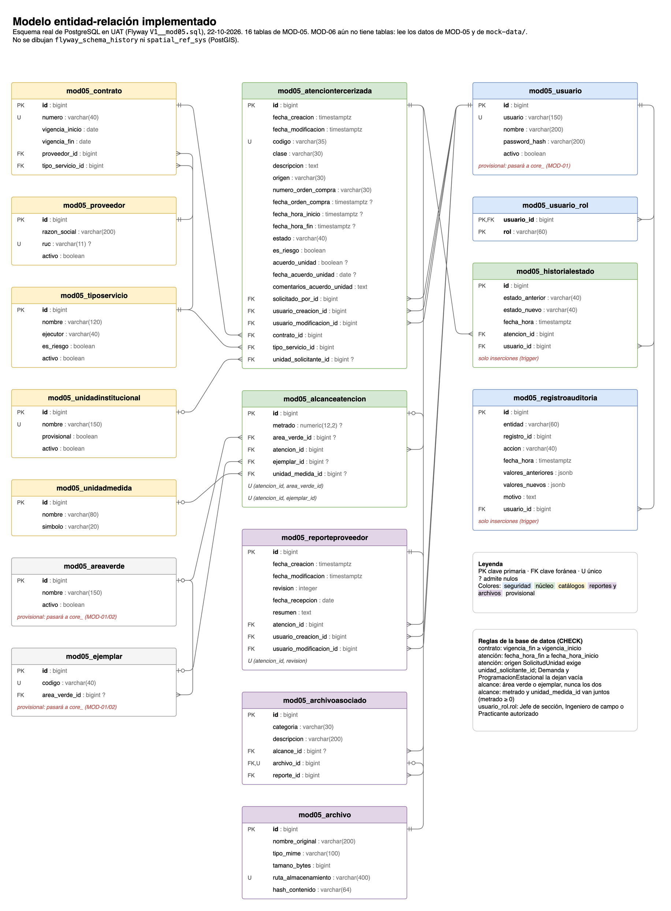

# Modelo entidad-relación



Esquema **real** de PostgreSQL tal como queda tras las migraciones de Flyway. Se sacó de la base de UAT el 22-10-2026 (`V1__mod05.sql`).

- 16 tablas, todas de MOD-05. MOD-06 todavía no tiene tablas propias: lee los datos de MOD-05 y de `mock-data/`.
- Pendiente de dibujar: MOD-01 añade `core_rol`, `core_usuario`, `core_permiso`, `core_rol_permiso`, `core_sesion`, `core_registro_auditoria`, `core_registro_acceso`, `core_archivo` y `core_adjunto` (`V6` a `V10`, ver [mod01.md](../modulos/mod01.md)). `core_usuario` copia `mod05_usuario` con los mismos `id`, y las dos tablas de bitácora solo admiten inserciones.
- `mod05_usuario`, `mod05_areaverde` y `mod05_ejemplar` son provisionales. Cuando MOD-01 y MOD-02 publiquen sus tablas `core_`, MOD-05 las referenciará y estas se retirarán con expand y contract (ver [base-datos.md](../estandares/base-datos.md), «Propiedad de las entidades»).
- `mod05_historialestado` y `mod05_registroauditoria` solo admiten inserciones: un trigger rechaza `UPDATE` y `DELETE`.
- No se dibujan `flyway_schema_history` ni `spatial_ref_sys` (PostGIS).

Este diagrama es el modelo implementado, no el modelo de datos completo del sistema, que está en los entregables del curso.

## Cómo se actualiza

La fuente es `modelo-er.drawio`: ábrelo en draw.io (escritorio o app.diagrams.net). Si una migración cambia el esquema, actualiza el diagrama en el mismo PR y vuelve a exportar el PNG:

```sh
drawio -x -f png -s 1.5 -b 20 -o docs/base-datos/modelo-er.png docs/base-datos/modelo-er.drawio
```

Notación: pata de gallo para «muchos», doble raya para «uno» y círculo para «cero o uno» (la FK admite nulos). PK clave primaria, FK clave foránea, U único, `?` admite nulos.
