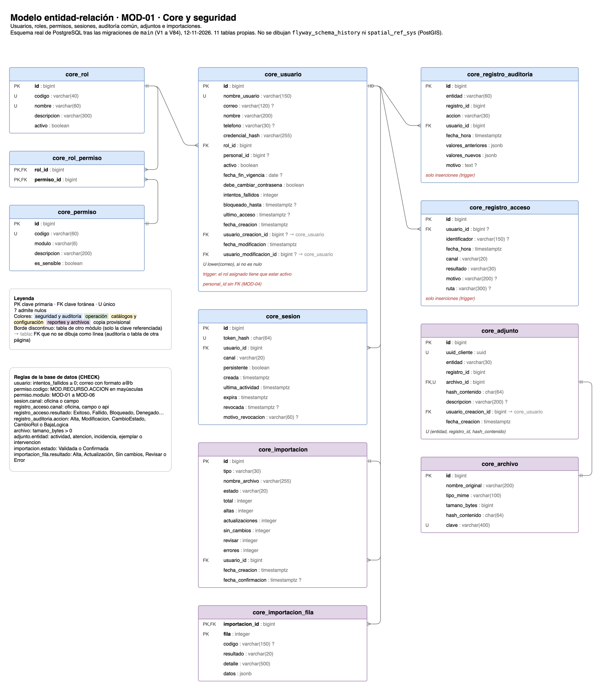
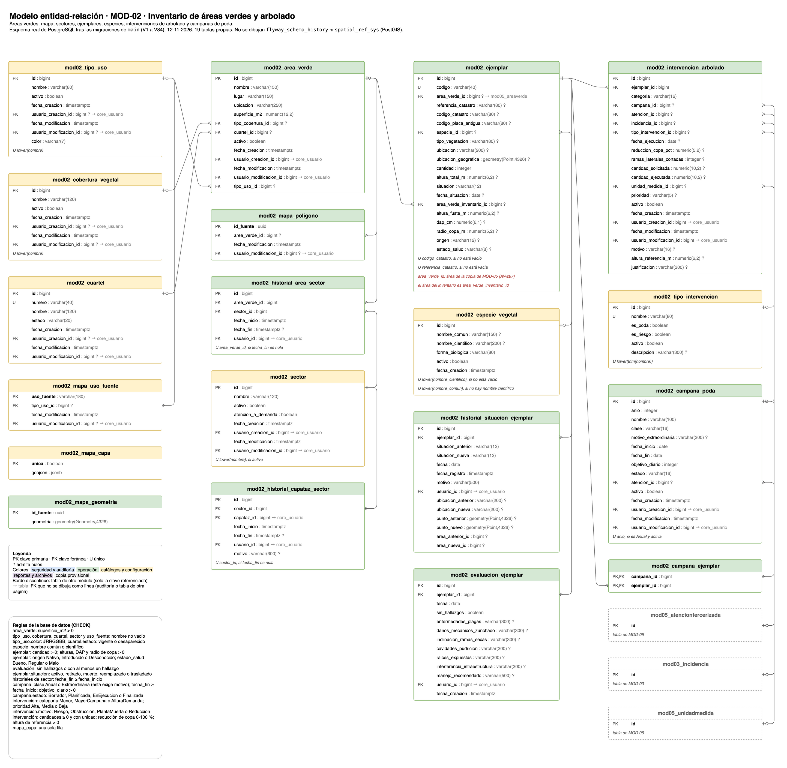
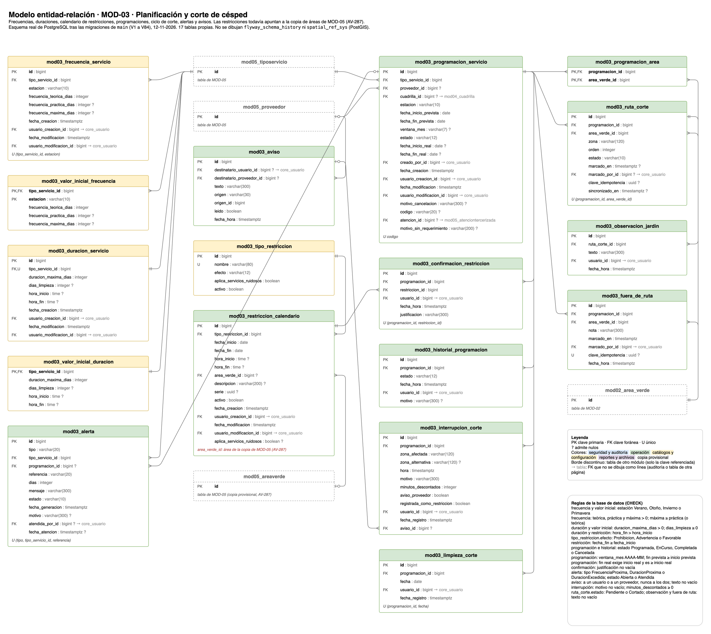
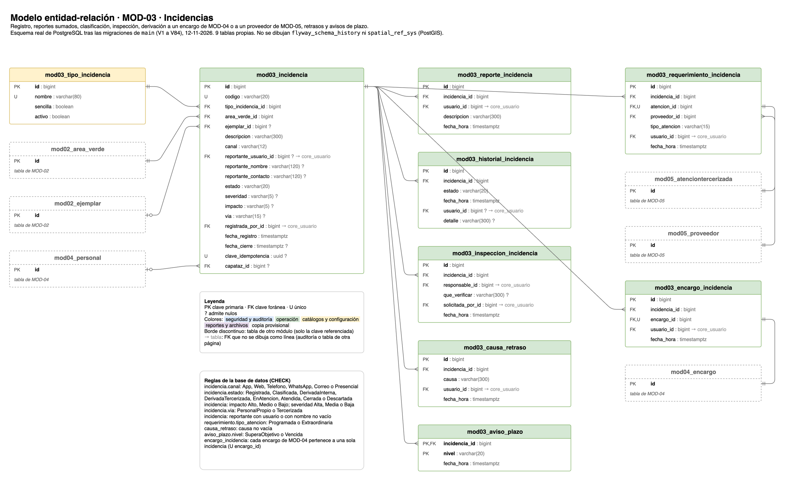
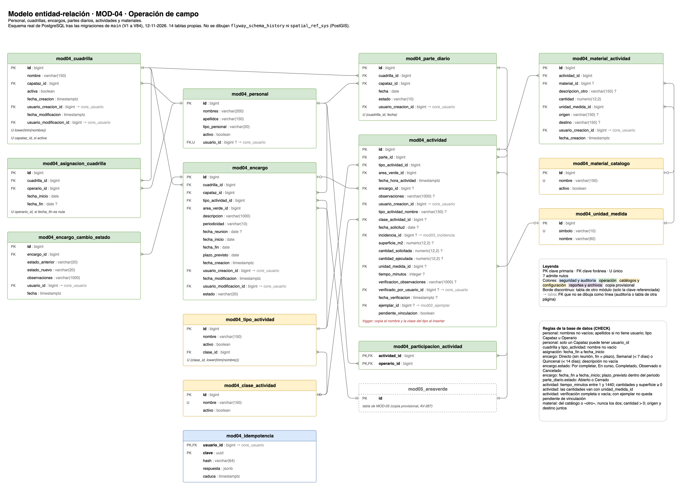
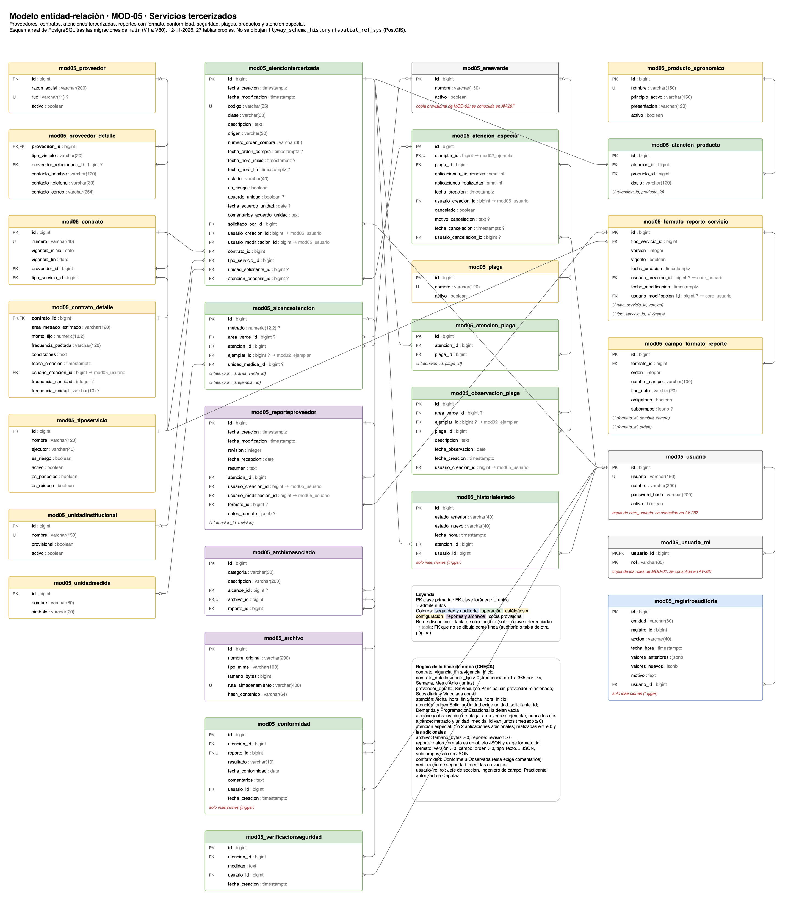
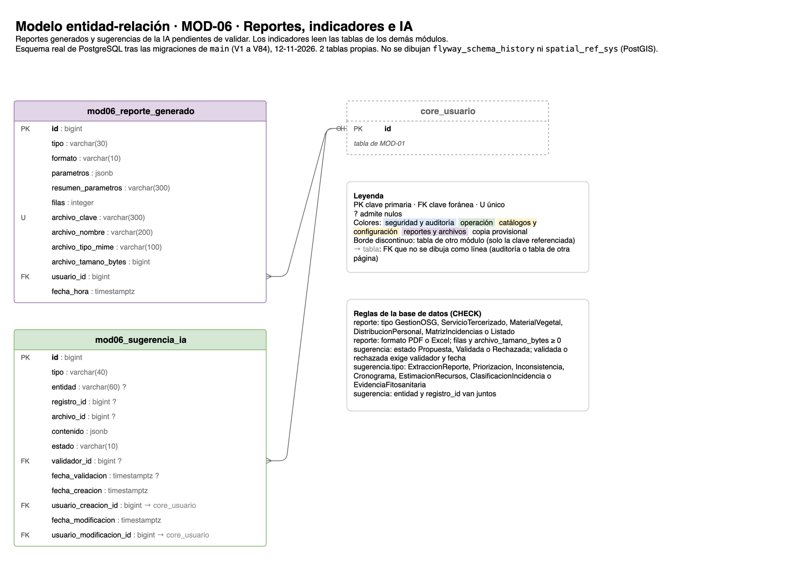

# Modelo entidad-relación

Esquema **real** de PostgreSQL tal como queda tras las migraciones de Flyway de `main` (`V1` a `V80`), sacado el 12-11-2026: 96 tablas. Hay una página por módulo en `modelo-er.drawio` (MOD-03 ocupa dos) y un PNG por página:

| Módulo | Migraciones | Tablas | Diagrama |
|---|---|---|---|
| MOD-01 · Core y seguridad | `V6` a `V10`, `V23`, `V24`, `V75` y `V76` | 11 (`core_`) | [modelo-er-mod01.png](modelo-er-mod01.png) |
| MOD-02 · Inventario | `V12` a `V22`, `V45`, `V46`, `V59`, `V62` a `V67`, `V71` y `V80` | 18 | [modelo-er-mod02.png](modelo-er-mod02.png) |
| MOD-03 · Planificación y corte | `V2` a `V4` y `V25` a `V44` | 17 | [modelo-er-mod03.png](modelo-er-mod03.png) |
| MOD-03 · Incidencias | `V25` a `V44` y `V79` | 8 | [modelo-er-mod03-incidencias.png](modelo-er-mod03-incidencias.png) |
| MOD-04 · Operación de campo | `V11`, `V54` a `V58`, `V60`, `V61`, `V68`, `V69` y `V78` | 13 | [modelo-er-mod04.png](modelo-er-mod04.png) |
| MOD-05 · Servicios tercerizados | `V1`, `V5`, `V47` a `V53`, `V70`, `V73`, `V74` y `V77` | 27 | [modelo-er-mod05.png](modelo-er-mod05.png) |
| MOD-06 · Reportes e IA | `V72` | 2 | [modelo-er-mod06.png](modelo-er-mod06.png) |















## Qué conviene saber

- Siguen tres copias provisionales en MOD-05: `mod05_usuario` y `mod05_usuario_rol` (de MOD-01) y `mod05_areaverde` (de MOD-02). Se consolidan en las tablas del dueño con expand y contract en AV-287 (ver [base-datos.md](../estandares/base-datos.md), «Propiedad de las entidades»).
- La copia de ejemplares ya no existe: `V15` renombró `mod05_ejemplar` a `mod02_ejemplar`. Su `area_verde_id` todavía apunta a `mod05_areaverde`; el área del inventario es `area_verde_inventario_id` (`V67`), que apunta a `mod02_area_verde`.
- También apuntan a `mod05_areaverde`: `mod03_restriccion_calendario`, `mod04_encargo`, `mod04_actividad`, `mod05_alcanceatencion` y `mod05_observacion_plaga`. Las tablas nuevas de MOD-03 (ruta de corte, incidencias) ya usan `mod02_area_verde`.
- MOD-05 sigue apuntando a `mod05_usuario` (atención, atención especial, historial de estados, auditoría, conformidad y verificación de seguridad); el resto de módulos usa `core_usuario`.
- `core_usuario` copió `mod05_usuario` con los mismos `id`. `core_usuario.personal_id` apunta a MOD-04 sin clave foránea.
- Solo admiten inserciones (un trigger rechaza `UPDATE` y `DELETE`): `core_registro_auditoria`, `core_registro_acceso`, `mod05_historialestado`, `mod05_registroauditoria` y `mod05_conformidad`.
- `mod04_actividad` guarda el nombre y la clase del tipo de actividad al insertarse (trigger), para que el histórico no cambie si se renombra el tipo.
- No se dibujan `flyway_schema_history` ni `spatial_ref_sys` (PostGIS).

Este diagrama es el modelo implementado, no el modelo de datos completo del sistema, que está en los entregables del curso.

## Cómo se lee

- Pata de gallo para «muchos», doble raya para «uno» y círculo para «cero o uno» (la FK admite nulos).
- PK clave primaria, FK clave foránea, U único, `?` admite nulos. Las filas en cursiva gris son únicos compuestos o parciales; las rojas, notas.
- Las FK de auditoría (`usuario_creacion_id`, `usuario_modificacion_id`) y las que apuntan a una tabla de otra página no se dibujan como línea: la columna lleva `→ tabla`.
- Las tablas con borde discontinuo son de otro módulo y solo muestran la clave referenciada.
- Cada página termina con las reglas `CHECK` de sus tablas.

## Cómo se actualiza

Si una migración cambia el esquema, regenera el diagrama en el mismo PR. `generar-modelo-er.py` crea una base temporal, le aplica las migraciones en orden, lee el esquema, la borra y escribe `modelo-er.drawio`. Si está el CLI de draw.io, exporta también los PNG. Necesita `psql` y el PostGIS de pruebas ([pruebas.md](../estandares/pruebas.md)):

```sh
PGHOST=127.0.0.1 PGPORT=55432 PGUSER=areas_verdes PGPASSWORD=solo-pruebas \
  python3 docs/base-datos/generar-modelo-er.py
```

Una tabla nueva hay que colocarla en una columna de `PAGINAS` y darle color en `CATEGORIA`. Si falta alguna de las dos cosas, el script lo dice y no escribe nada. Un módulo nuevo es una entrada nueva en `PAGINAS`, con sus reglas en `REGLAS`, que genera su página y su PNG; añádelo también a la tabla de arriba. Si un módulo no cabe en una página, se parte en varias con el mismo `prefijo` (como MOD-03).

No edites el `.drawio` a mano: la siguiente ejecución del script borraría el cambio.
