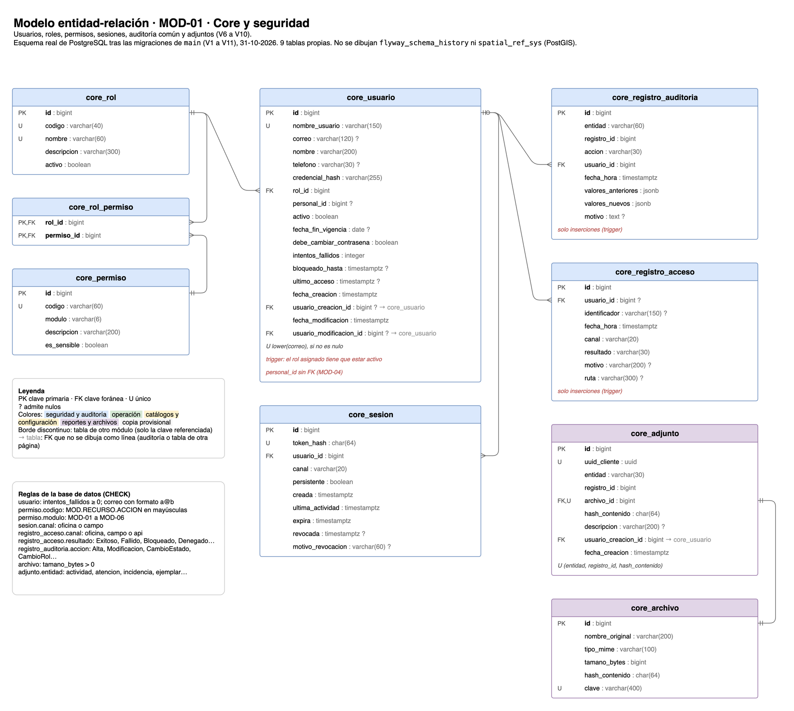
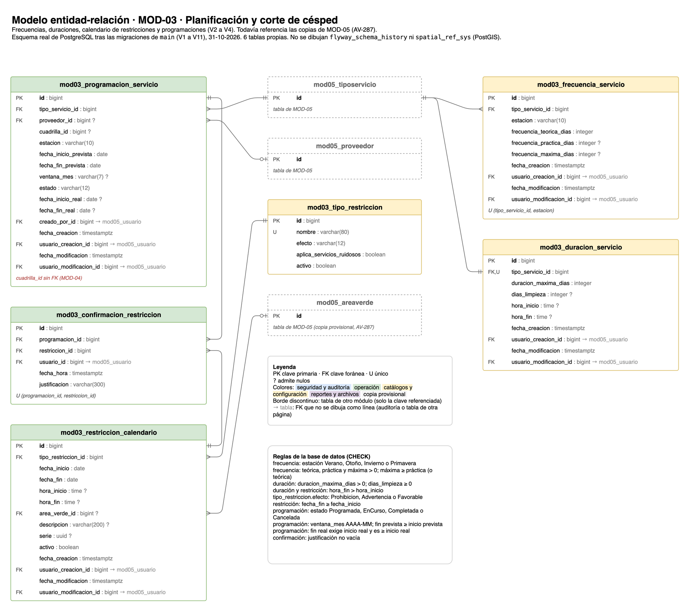
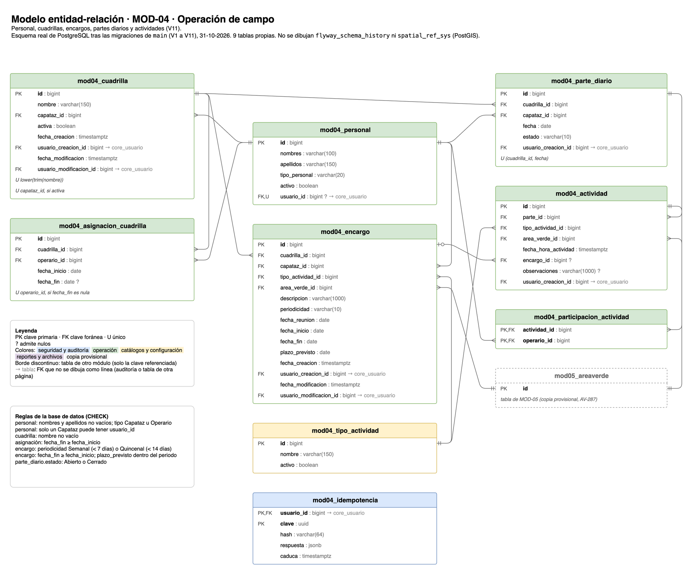
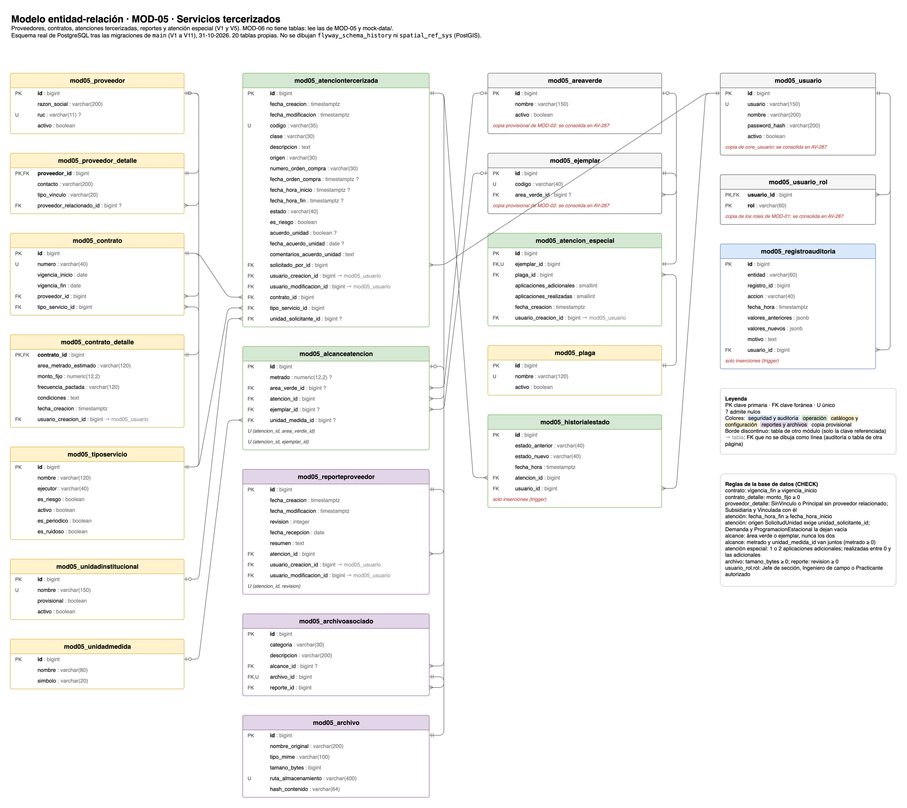

# Modelo entidad-relación

Esquema **real** de PostgreSQL tal como queda tras las migraciones de Flyway de `main` (`V1` a `V11`), sacado el 31-10-2026: 44 tablas. Hay una página por módulo en `modelo-er.drawio` y un PNG por página:

| Módulo | Migraciones | Tablas | Diagrama |
|---|---|---|---|
| MOD-01 · Core y seguridad | `V6` a `V10` | 9 (`core_`) | [modelo-er-mod01.png](modelo-er-mod01.png) |
| MOD-03 · Planificación | `V2` a `V4` | 6 | [modelo-er-mod03.png](modelo-er-mod03.png) |
| MOD-04 · Operación de campo | `V11` | 9 | [modelo-er-mod04.png](modelo-er-mod04.png) |
| MOD-05 · Servicios tercerizados | `V1` y `V5` | 20 | [modelo-er-mod05.png](modelo-er-mod05.png) |

MOD-02 todavía no tiene tablas en `main` (konoha-backend#37). MOD-06 tampoco: lee los datos de MOD-05 y de `mock-data/`.









## Qué conviene saber

- `mod05_usuario`, `mod05_usuario_rol`, `mod05_areaverde` y `mod05_ejemplar` son copias provisionales de entidades de MOD-01 y MOD-02. MOD-03 y MOD-05 todavía las referencian, y MOD-04 usa `core_usuario` pero también `mod05_areaverde`. Se consolidan en las tablas del dueño con expand y contract en AV-287 (ver [base-datos.md](../estandares/base-datos.md), «Propiedad de las entidades»).
- `core_usuario` copió `mod05_usuario` con los mismos `id`.
- `mod03_programacion_servicio.cuadrilla_id` y `core_usuario.personal_id` apuntan a MOD-04 sin clave foránea.
- Solo admiten inserciones (un trigger rechaza `UPDATE` y `DELETE`): `core_registro_auditoria`, `core_registro_acceso`, `mod05_historialestado` y `mod05_registroauditoria`.
- No se dibujan `flyway_schema_history` ni `spatial_ref_sys` (PostGIS).

Este diagrama es el modelo implementado, no el modelo de datos completo del sistema, que está en los entregables del curso.

## Cómo se lee

- Pata de gallo para «muchos», doble raya para «uno» y círculo para «cero o uno» (la FK admite nulos).
- PK clave primaria, FK clave foránea, U único, `?` admite nulos. Las filas en cursiva gris son únicos compuestos o parciales; las rojas, notas.
- Las FK de auditoría (`usuario_creacion_id`, `usuario_modificacion_id`) y las que apuntan a una tabla de otra página no se dibujan como línea: la columna lleva `→ tabla`.
- Las tablas con borde discontinuo son de otro módulo y solo muestran la clave referenciada.
- Cada página termina con las reglas `CHECK` de sus tablas.

## Cómo se actualiza

La fuente es `modelo-er.drawio`: ábrelo en draw.io (escritorio o app.diagrams.net). Si una migración cambia el esquema, actualiza su página en el mismo PR y vuelve a exportarla. Cada página se exporta por su número (1 MOD-01, 2 MOD-03, 3 MOD-04, 4 MOD-05):

```sh
drawio -x -f png -s 1.5 -b 20 -p 2 -o docs/base-datos/modelo-er-mod03.png docs/base-datos/modelo-er.drawio
```

Un módulo nuevo (MOD-02) va en una página nueva con su PNG, y se añade a la tabla de arriba.
